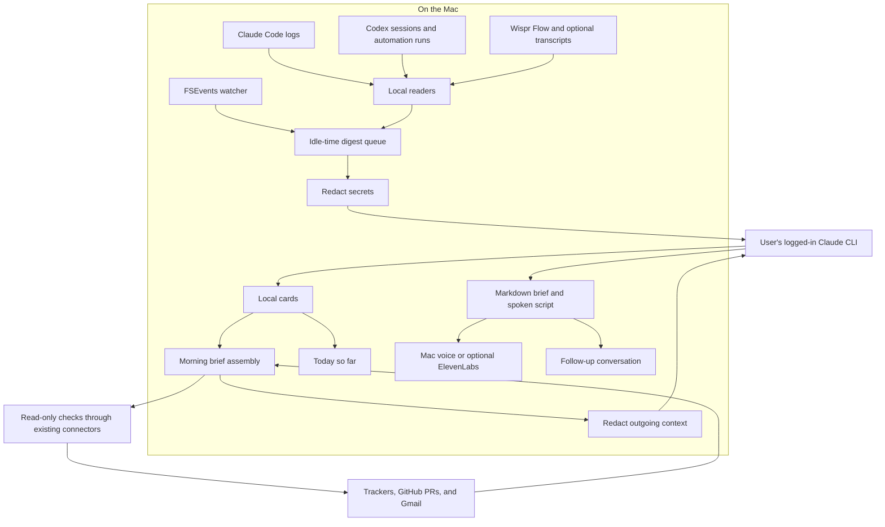
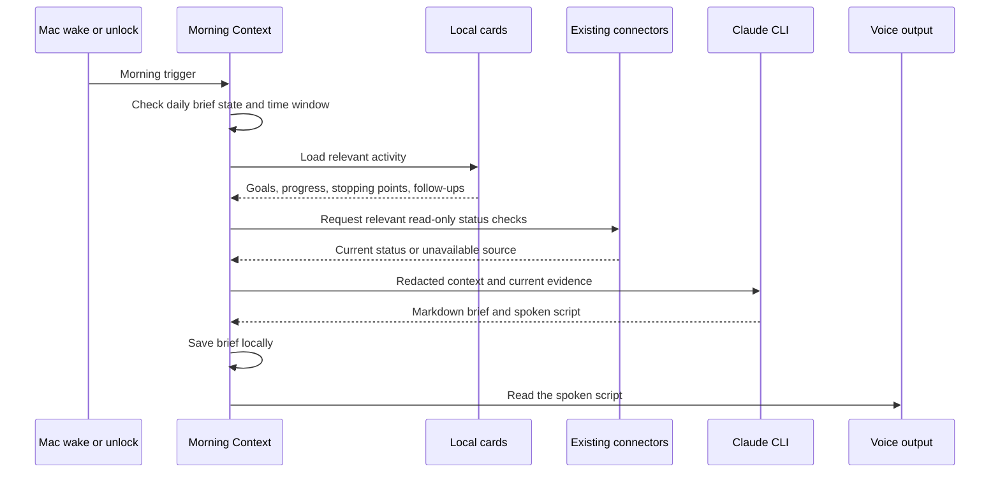
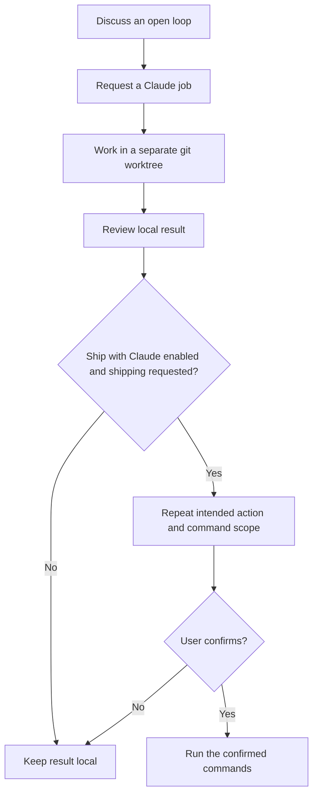

Some mornings, the first thing I do is reconstruct yesterday.

I open Claude Code to find where a fix stopped. Then Codex to check another project. Then GitHub to see whether a PR actually merged. Somewhere in between, I remember an outreach automation that was supposed to run and a meeting where I promised to follow up.

The work is spread across repositories, agent conversations, transcripts, and tools. Each one holds a piece of the story. Putting it back together can eat twenty minutes before I write any code.

I'm building **[Morning Context](https://github.com/Blackrose-blackhat/MorningContext)** to make that first part of the day quieter.

It's a free, MIT-licensed macOS menu-bar app. When I open my Mac in the morning, it collects yesterday's work, asks Claude to write a brief, and reads a roughly two-minute version aloud. Then I can ask questions about my day.

This post covers how it works today, the system design I'm building toward, and the trade-offs behind it. I use it daily, but I'm still its only user. The benefits below are what I'm trying to validate with testers.

## The problem is recovering context

Using several coding agents changes what I need to remember.

I might have one agent debugging an API, another working on a client website, and a scheduled run researching leads. A session can end with a useful answer while the actual work is still unfinished. A patch can exist locally without being pushed. An outreach draft can be ready without ever being sent.

A useful morning brief needs to answer a few concrete questions:

- What was I trying to do in each project?
- What actually got done, and where did I stop?
- Which automations ran, failed, or need attention?
- Who is waiting on me?
- What should I pick up first today?

That last question depends on the others. A list of yesterday's messages is too much to read. A confident summary with no connection to current reality is too easy to trust.

## The architecture: collect, digest, reconcile, speak

The released 1.2.x app collects activity when it prepares a brief. The next version adds **cards**: small summaries created during idle time as sessions, automation runs, and meetings finish. Cards, **Today so far**, and **Ship with Claude** are on a branch I'm preparing to merge.

Here is the architecture I'm building toward:



The local readers collect evidence. Claude interprets it. Live checks establish what has changed since the evidence was recorded. The app presents the result as both a readable brief and a shorter spoken script.

The local boundary matters, but it needs a precise explanation: **collection happens locally; summarization uses Claude through the user's own CLI login.** Redacted context leaves the Mac for that step. Optional connectors access external services, and ElevenLabs receives the spoken text if enabled.

## 1. Read the activity that already exists

The app starts with files that the tools already write:

- **Claude Code:** session logs under `~/.claude/projects`.
- **Codex:** local sessions and scheduled automation activity under `~/.codex`.
- **Wispr Flow:** meetings, notes, and dictations from its local SQLite database, opened read-only.
- **Optional transcripts:** a folder of exported transcript files.

Each source needs its own reader because its structure and meaning differ. A coding conversation has a goal and a stopping point. A meeting has people and commitments. An automation has an intended task and evidence of what happened during the run.

The released Claude reader keeps conversation turns and information about tools and files touched, while dropping tool output to reduce noise. The digest groups work by repository and branch. Long sessions are bounded so the beginning and end survive: the original goal and the last known state are often the most useful parts.

Reading Wispr Flow through a read-only SQLite connection also keeps collection from writing to its database. SQLite here is a source adapter; it doesn't imply that the whole app needs a database server.

The limitation is coverage. If a conversation or action isn't present in a supported source, Morning Context can't reconstruct it reliably. Missing evidence should stay visible as a gap.

## 2. Turn finished work into cards during idle time

The biggest change in the next version is when summarization happens.

If I wait until morning to interpret every session, the first brief has to process a day's worth of raw history at once. Instead, I'm moving that work into small background steps throughout the day.

An FSEvents watcher notices local changes. As a session, automation run, or meeting finishes, the app digests it into a card, using one small Claude call while I'm idle.

A card captures the goal, what got done, where the work stopped, people involved, and follow-ups. Conceptually, one might read like this:

```text
Project: atlas
Source: coding session
Goal: fix duplicate webhook processing
Done: added a deduplication check and ran the relevant tests
Left off: local changes ready for review; push not confirmed
People: none mentioned
Follow-up: inspect the diff and check the PR status
```

That's an illustrative card, not a claim about a real Atlas session or the exact storage format.

The phrase **push not confirmed** is doing useful work. An agent saying a fix is complete doesn't establish that it reached the remote repository.

Cards give me smaller units to assemble, inspect, and discuss. They also power **Today so far**, which exposes the day's cards from the menu bar. The same context should be useful at 3 p.m. when I switch projects, as well as the next morning.

This design moves some model work out of the morning. It doesn't automatically guarantee lower total usage: a busy day can produce many cards. Idle scheduling protects the timing of that work, while bounded inputs help control its size. Latency and usage still need measurement.

## 3. Check what is true this morning

A card is a record of a moment. A ticket or PR can change after that moment.

Morning Context uses the Claude and Codex connectors the user already has to make relevant read-only checks against tools such as Jira, Azure Boards, GitHub, and Gmail. The released intake flow plans which checks are worth making and runs them in the repository context they belong to.

In the card-based design, the morning sequence looks like this:



For example, yesterday's card might say a PR is waiting for review. This morning's check might show that it merged overnight. Both facts have a place: one explains yesterday's stopping point; the other changes today's next action.

An unavailable inbox or tracker must also remain distinguishable from an empty one. "Couldn't check Gmail" and "Nobody is waiting on you" are very different messages. That's a correctness requirement for this design, not something a fluent summary can solve on its own.

## 4. Make “every morning” work on a laptop

A laptop is asleep for much of the time a conventional scheduled job would expect it to be running.

The released app listens for wake, screen-wake, and unlock events, with a fifteen-minute poll as a fallback. The first trigger after the configured earliest hour generates the day's brief. Later wakes reopen the same day without automatically generating another brief.

By default, the activity window covers yesterday at midnight through the current moment. If the previous brief is older, it can extend back to the end of that brief, capped at seven days. That helps with Monday mornings and days away from the Mac.

The daily gate matters because one lid-open can produce several related events. Users need one morning brief, and they can explicitly regenerate it when needed.

## 5. Write for reading and listening

The brief has room for detail:

- TL;DR.
- What I worked on, grouped by project.
- Outreach and automations.
- Tasks and tickets.
- Inbox.
- Meetings.
- Open loops for today.
- Worth remembering.

The spoken script is a separate output. Reading all those sections aloud would make the morning routine longer than it needs to be. Claude produces the Markdown brief and the roughly two-minute script together, so I can listen first and open the detail when something needs attention.

The default voice uses the Mac's speech engine. ElevenLabs is optional, with the user's own key. Follow-up conversation lets me interrupt and ask something specific, such as “What was I doing in atlas?” or request a copy-ready follow-up draft.

Briefs are saved locally as Markdown. The released summarization flow also falls back to showing the raw digest if the Claude CLI fails. The underlying activity remains useful even when the polished version isn't available.

## 6. Hand work back to Claude with a clear scope

Remembering an unfinished task naturally leads to wanting help with it.

The existing Claude Jobs handoff is opt-in. A request such as “get Claude on it” starts a background Claude Code job in its own git worktree. The default job can commit locally and doesn't push.

The upcoming **Ship with Claude** flow adds an explicitly enabled path for requests such as “open a PR” or “merge it into main.” It repeats the intended action, waits for confirmation, and runs with only the exact commands for that action pre-approved.



A worktree separates the job's checkout from the one I'm actively using. It isn't a security sandbox. The confirmation and command scope are separate parts of the design: permission to summarize a session doesn't imply permission to publish its code.

## Privacy and the cost of keeping it small

Morning Context has no backend server or telemetry. It uses the user's logged-in `claude` CLI, so there's no separate model API key to configure. That also means it depends on Claude Code access and its applicable usage limits. Without Claude Code, the app does nothing by design.

Secrets such as API keys, tokens, and passwords are redacted before outgoing context is sent. Redaction reduces exposure; it doesn't make the remaining work context non-sensitive. The [README documents what leaves the Mac](https://github.com/Blackrose-blackhat/MorningContext#privacy-what-leaves-your-mac), including the optional voice service and connector checks.

I'm building the Mac app with Swift, SwiftUI, AppKit, and SwiftPM for macOS 13 and later, with no third-party dependencies. Native file watching, speech, and read-only SQLite access cover much of what it needs. The test suite currently has 87 Swift Testing tests; that is a starting point, not proof that it handles everybody's workflow.

The website uses Next.js static export, Tailwind, and shadcn/ui on GitHub Pages. The monorepo separates the Mac app and website under `apps/mac` and `apps/web`.

I'm one person building this in India with no project budget. Free hosting and the user's existing CLI access make the current experiment possible. Releases are ad-hoc signed and aren't notarized yet, so installation requires the macOS “Open Anyway” step. Notarization and payments are later work, if testers find enough value in the app.

## The reliability work still ahead

The card pipeline introduces questions I need to verify against real daily use:

- **Repeated file events:** one growing session should not create several cards describing the same work.
- **A session that resumes:** its next digest should reflect the new stopping point without losing the original goal.
- **Interrupted background work:** an app restart or failed Claude call should leave activity available to retry.
- **Missing sources:** unreadable logs and unavailable connectors should appear as gaps in coverage.
- **Conflicting evidence:** a summary should preserve uncertainty until a current check resolves it.

These are design requirements I'm working through, rather than guarantees I'm claiming for the branch. Testing needs ordinary messy inputs: sessions that span midnight, automations with incomplete output, a sleeping Mac, and an inbox connector that fails.

## What I hope it gives back

The benefit I'm looking for is a shorter path from opening the laptop to knowing what to do.

A project block can restore the reason behind yesterday's code changes. An automation section can surface a run that needs inspection. A meeting follow-up can remind me that someone is waiting. A spoken brief lets me get oriented without immediately opening another set of tabs.

I haven't measured a general time saving or validated demand. I'm preparing to send it to a handful of testers and find out whether the brief is accurate, whether it catches useful open loops, and whether they keep using it after the first few mornings. I'm also exploring whether enough value exists for an optional paid offering around $10 a month; the project is free and open source today.

The next evidence I need is simple: does it help someone resume a real project faster, or remember something they would otherwise have missed?

That's the morning I want to build toward: open the Mac, hear where things stand, and start with a little less to hold in my head.

You can read the code, try a release, or follow the work on [GitHub](https://github.com/Blackrose-blackhat/MorningContext).
